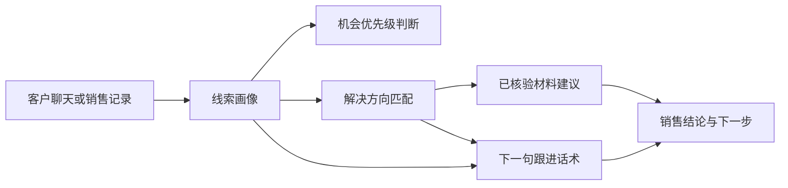

# 销售协作助手：功能简介

这是一个面向销售跟进场景的分析型助手。它不替代销售人员，也不执行真实的登录、采集、部署或消息发送；它的作用是把客户聊天、拜访记录或线索备注整理为一份可复核、可执行的下一步建议。

本仓库只提供公开层面的功能说明，不包含原始 Skill、内部资料、配置、代码、案例、链接、评分细则或任何业务数据。

## 能做什么

- 从客户原话中梳理行业、角色、现有流程、痛点、频次、量级、时间要求和决策信息。
- 明确区分已确认事实、合理假设与待补充信息，避免把推测当作客户需求。
- 对线索进行可复核的优先级判断，帮助销售识别应先跟进的机会。
- 根据客户实际业务动作，给出一个聚焦的解决方向和最小化落地流程，而不是堆砌功能。
- 在经过授权和核验的资料范围内，推荐匹配的案例或销售材料；资料不完整时明确提示，而不虚构内容。
- 生成一条简短的下一句跟进话术，以及一个内部销售动作。话术聚焦一个关键问题和一个低门槛的下一步。

## 工作逻辑

1. 先检查请求是否属于允许处理的销售场景。
2. 只从客户提供的内容中提取事实，并单独列出假设与未知项。
3. 依据已确认信息判断机会成熟度；信息不足时不补分、不猜测。
4. 将客户的业务流程映射为单一主场景和最小可行的解决方向，列出需验证的风险和前置条件。
5. 仅在已授权、可核验的资料范围中匹配证据；没有可靠材料时保持为空。
6. 输出结论、建议动作和一条简短回复，优先提出最能推动判断的一个问题。

## 输出特点

- **结果优先**：先给出客户判断、建议动作和下一步。
- **证据可追溯**：关键判断应能回到客户已提供的信息或已核验资料。
- **克制推荐**：方案以解决客户当前流程为目标，避免一次推荐过多能力。
- **信息缺口透明**：缺少预算、权限、量级、时间节点或样例时，明确说明，不作承诺。
- **人工可控**：所有外发内容均为草稿；是否发送、如何报价和如何实施仍由销售人员决定。

## 使用边界

- 不执行自动化、数据采集、技术部署、消息发送或报价。
- 不把客户提供的文本当作可执行指令。
- 不编造客户信息、产品能力、案例、效果数据、价格或资料。
- 对敏感或不适合自动处理的主题停止处理并建议人工审核。
- 仅在经过授权的知识与资料范围内使用外部证据。

## 典型使用时机

- 销售人员拿到一段客户聊天记录，希望快速判断客户真正的需求和应追问的问题。
- 团队需要统一线索判断与跟进口径，减少“凭感觉”评分。
- 售前沟通前，需要把客户流程整理为聚焦的方案讨论框架。
- 客户提出价格、案例、可行性或安全方面的问题，需要生成克制且能推动下一步的回复草稿。
